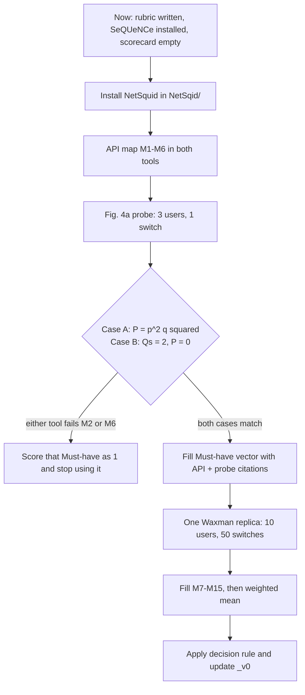

# Next steps to complete the MUERP simulator rating

The scorecard in `rating_metrics.md` is the remaining analysis. `_v0.tex` is architecture, not evidence, and the sheet is still empty. Finish it in this order: **install NetSquid → map APIs to M1–M6 → run the Fig. 4a probe in both tools → fill Must-haves → one Waxman replica → apply the decision rule.** Do not implement Algorithms 1–4 or the Sec. V sweep until Must-haves pass.

**Where you are.** Metrics and weights are done. SeQUeNCe 1.3.1 is installed and the Timeline smoke test passed. `NetSqid/` is empty. Nothing has been scored. `_v0.tex` must not be copied into the table: the rubric forbids marketing language and requires a matched probe.

---

## 1. Install NetSquid (blocking)

You cannot fill a two-column sheet with one tool. Put it in `/Users/alexandrabouillon/Documents/Quantum_Networking/NetSqid` the same way SeQUeNCe was isolated. After `import netsquid` works, stop. Do not start MUERP graphs yet.

## 2. API map only — Must-haves, both tools

For each of M1–M6, write the **class or call** you would use, or “none.” Do not put a 1–5 in the sheet yet.

| Metric | What to look up | SeQUeNCe lead to verify, not score |
|---|---|---|
| M1 | Arbitrary graph; users vs switches | `generate-topology` / `build_waxman`; check whether users are a distinct type or both are `QuantumRouter` |
| M2 | `Q_r`, 2 qubits/channel, refusal | `MemoryArray` + `Reservation.memory_size`; does exhaustion refuse or silently share? |
| M3 | Two-qubit BSM, constant `q` | `SingleAtomBSM` / `SingleHeraldedBSM`; can `q` be set to 0.9? |
| M4 | `p = exp(-α L)` | length + attenuation on quantum channels vs you precomputing `p` |
| M5 | Pin path + memories **before** the run | `StaticRoutingProtocol` + `Reservation.path` vs the default RSVP stack still choosing |
| M6 | Logs for Eq. (1)–(2) and `P = 0` | metrics API vs reconstructing from traces |

Do the same for NetSquid (`Network`, `QuantumProcessor`, `BSM`, `FibreLossModel`, custom protocol). If a Must-have has **no hook**, that tool is already a 1 and you do not need a large experiment.

## 3. Fig. 4a probe (this is the analysis)

Same instance in **both** simulators (`rating_metrics.md` lines 192–200):

- 3 users (Alice, Bob, Carol) + 1 switch S, star of fibers
- Equal link success `p`, swap success `q`
- Two channels: Alice–Bob and Alice–Carol, each two links + one swap
- **Case A:** `Q_S = 4` → both channels reserved → `P = (p²q)²`
- **Case B:** `Q_S = 2` → infeasible → `P = 0`

If either tool cannot get both cases right, it **fails M2/M6** no matter what `_v0.tex` says. That is the gate. You do **not** need Algorithms 1–4 for this: the tree is the two channels in Fig. 4a.

Also record here, cheaply: independent qubits per channel (M7), product of two pairwise sessions (M8), and whether you can ignore wait/decoherence so Eq. (1)–(2) are recoverable (M10).

## 4. Fill Must-haves, then one Waxman replica

Fill M1–M6 with **score + evidence** (API name, doc URL, or probe result). Report the Must-have vector **and** the mean. A Must-have 1 means that tool is not usable for reproduction.

Only if no Must-have is 1, run **one** Sec. V-A default replica (not 20):

- Waxman, 10 users, 50 switches, degree 6, `Q_r = 4`, `q = 0.9`, `α = 10^{-4}`, area `10k × 10k`
- Record tree `P`, per-switch occupancy, wall-clock, peak memory

That single run is M9/M14. SeQUeNCe already has `generate-topology waxman`; NetSquid will need an explicit graph import. Do **not** use a 1,000-node repeater number.

## 5. Fill M7–M15 and apply the decision rule

M11–M13 can stay mostly doc-based after the probe (fidelity/wait, two trees sharing `Q_r`, whether you can replace entanglement/resource modules). Then apply the rule already in the file:

- Gap is **M5 or M2** → default to SeQUeNCe
- Gap is **M10/M11** → default to NetSquid
- Both pass Must-haves → pick on **M13** vs **M9/M14**

Rewrite `_v0.tex` from the filled sheet, not the other way around. Point `rating_metrics.md` at `_v0.tex` (it currently cites `_v0.md`).

---

## Do not do yet

These complete MUERP, not the rating:

- Algorithms 1–4 and E-Q-CAST / N-FUSION
- 20-graph sweeps and Figs. 5–8
- Scoring “who is faster” on unmatched workloads
- Filling the table from `_v0.tex`

A high score means *this simulator can host MUERP under the paper’s assumptions.* After the sheet is filled, implementing Algs 1–4 is the **next project**, in the chosen tool.
